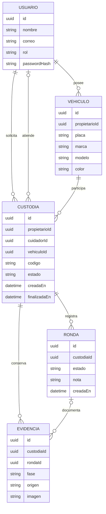
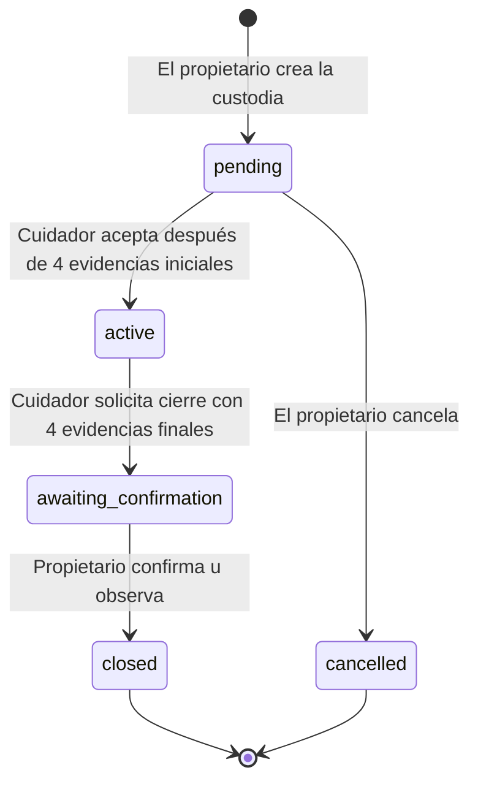

# Arquitectura y decisiones de la fase inicial

## Propósito y alcance

CuidaTuAuto registra un servicio de custodia desde la entrega del vehículo hasta su devolución. La propietaria consulta las evidencias y rondas; el cuidador registra el servicio y solicita su cierre. Se busca trazabilidad: quién intervino, qué registró y cuándo.

Se implementa una aplicación con dos roles. Esta decisión reduce la duplicación de pantallas y lógica frente a desarrollar dos aplicaciones independientes. El backend decide qué operaciones puede realizar cada usuario. Un cambio visual de pantalla no concede permisos adicionales.

## Responsabilidades

| Componente | Tecnología | Responsabilidad |
|---|---|---|
| Frontend | Expo, React Native, TypeScript | Interfaz en español, formularios, navegación, QR, selección de imágenes, permisos y consulta de la API. |
| Backend | Node.js, Express, TypeScript | Autenticación, validación, permisos, transiciones de custodia, acceso a los datos y manejo de errores. |
| Persistencia inicial | PGlite en el backend | Ejecutar el esquema PostgreSQL y conservar los registros en archivos locales. |
| Persistencia externa | PostgreSQL mediante `pg` | Usar el mismo modelo SQL en una instancia administrada por el equipo o un proveedor. |

El frontend no recibe credenciales de PostgreSQL y no se conecta directamente al motor SQL. La URL pública de configuración corresponde a la API. El secreto JWT permanece en el backend.

## Modelo de datos

Los nombres siguientes expresan conceptos del dominio; consulta la migración del backend para los nombres SQL exactos.

Una custodia pendiente todavía no tiene cuidador. Las evidencias iniciales y finales no pertenecen a una ronda; por eso `roundId` puede ser nulo. Una ronda sí conserva su evidencia dentro de la misma transacción.

Al crear una custodia, el backend guarda además una copia de los datos del vehículo en `vehicle_snapshot` (JSONB). Así, editar posteriormente la placa, el color u otros datos del vehículo no reescribe lo que se muestra en una custodia anterior. La migración `002_vehicle_snapshot.sql` añade este campo y completa los registros previos a partir de los datos disponibles.

## Estados de custodia

El backend verifica cada transición. El vehículo solo puede tener una custodia abierta. La aceptación asigna el cuidador de forma atómica para evitar que dos cuidadores acepten el mismo código. Los estados cerrados conservan historial y no admiten nuevas rondas.

En esta fase, confirmar con observación cierra la custodia y conserva la nota. No inicia un sistema de disputas ni un proceso de indemnización.

## Evidencias y demostración

- Las imágenes de prueba están marcadas y su origen es `demo`.
- Las fotografías seleccionadas o capturadas conservan su origen (`upload` o `camera`).
- El momento del registro no demuestra por sí solo cuándo se tomó una imagen importada.
- Se admiten imágenes PNG, JPEG o WebP pequeñas. El límite de esta fase es 2 MiB binarios por imagen.
- La ubicación puede ser manual, de una lectura del dispositivo o de demostración. No hay seguimiento continuo.

Las imágenes se guardan inicialmente en SQL para facilitar una entrega autocontenida. Un siguiente paso será un almacenamiento de objetos con referencias autorizadas, límites de retención y carga optimizada. Firebase Storage forma parte de una posible evolución; no se presenta como integrado en esta entrega.

## Qué significa actualizar una pantalla

La app consulta la API para obtener el estado. Pulsar actualizar o volver a cargar datos no equivale a una notificación push. Las notificaciones remotas y la actualización en tiempo real son funcionalidades pendientes.

## Mapa de carpetas

| Ruta | Contenido |
|---|---|
| `frontend/` | Aplicación Expo, componentes, integración de API y configuración del cliente. |
| `backend/` | Servidor Express, migración SQL, acceso a datos, autenticación y pruebas. |
| `backend/assets/` | Ilustraciones identificadas como datos de prueba. |
| `backend/data/` | Datos locales y secreto de desarrollo creados al ejecutar. No se distribuyen en el ZIP. |
| `scripts/` | Preparación y ejecución coordinada desde la raíz. |
| `docs/` | Contrato de API, explicación técnica y guías de uso. |

## Fuentes

- [Expo: aplicaciones universales](https://docs.expo.dev/tutorial/introduction/).
- [PGlite: motor embebido y almacenamiento local](https://pglite.dev/docs/).
- [node-postgres: consultas parametrizadas](https://node-postgres.com/features/queries).
